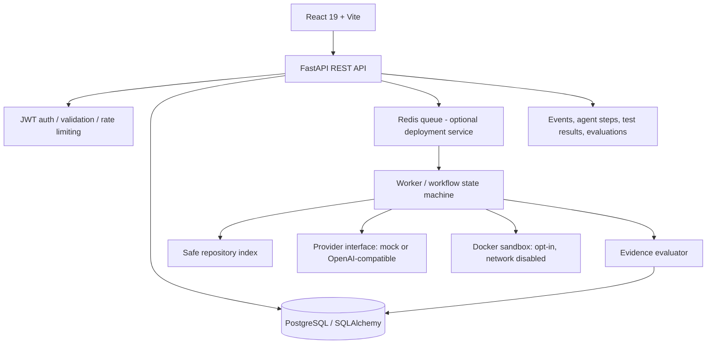

# AegisOS

AegisOS is a modular AI-assisted software-change workflow: register a repository, submit an issue, retrieve bounded source context, generate a patch, run checks in an isolated Docker container, and evaluate results using explicit evidence. A generated patch is never considered proof of correctness.

## Status and safety contract

This repository implements a runnable vertical slice with FastAPI, SQLAlchemy, Alembic, a deterministic mock provider, optional OpenAI-compatible provider, a React/Vite UI, persisted workflow events, task cancellation/rerun, experiment records, and Docker sandbox gating. The sandbox is **disabled by default** and execution returns `inconclusive` unless explicitly enabled and Docker is available. Do not expose this prototype to untrusted users without a security review. Tests cannot prove the absence of all bugs.

## Architecture



The current development worker runs as a bounded in-process background task for easy local startup. Redis is included in Compose for the production-oriented queue boundary, but the app does not claim distributed queue delivery guarantees. A future deployment should replace the in-process dispatcher with a durable Redis/RQ or Celery worker and reconcile orphaned running jobs at startup.

## Requirements

- Python 3.12+ (tested code targets Python 3.12+; Python 3.13 should also work)
- Node.js 20+ and npm
- Docker Engine / Docker Desktop for Compose and optional sandbox execution
- PostgreSQL and Redis (Compose supplies both)

## Windows PowerShell quick start

```powershell
Copy-Item .env.example .env
# Edit .env and set a unique JWT_SECRET before sharing or deploying.
docker compose up -d db redis
py -3.12 -m venv .venv
.\.venv\Scripts\Activate.ps1
python -m pip install --upgrade pip
pip install -e ".[dev]"
alembic upgrade head
python scripts/seed.py
uvicorn app.main:app --reload --app-dir backend
```

In another terminal:

```powershell
cd apps/web
npm install
npm run dev
```

Open `http://localhost:5173`. API docs: `http://localhost:8000/docs`.

The seeded local demo account is `demo@aegisos.dev` / `AegisOS-demo-password-2026`. Re-run `python scripts/seed.py` if the demo account needs to be created or its local demo password restored. Older databases using `demo@aegisos.local` are migrated by the seed script when the canonical `.dev` account does not yet exist.

## Linux/macOS quick start

```bash
cp .env.example .env
# Edit .env and set a unique JWT_SECRET.
docker compose up -d db redis
python3.12 -m venv .venv
source .venv/bin/activate
python -m pip install --upgrade pip
pip install -e '.[dev]'
alembic upgrade head
python scripts/seed.py
uvicorn app.main:app --reload --app-dir backend
```

In another terminal: `cd apps/web && npm install && npm run dev`.

## Full container startup

`docker compose up --build` starts API, PostgreSQL, and Redis. The development Compose profile intentionally does not enable untrusted code execution. For local UI development, use Vite separately as above. API health: `/health`; readiness: `/ready`; metrics: `/metrics`.

## Configuration

See `.env.example`. Defaults use PostgreSQL, mock provider, and disabled sandbox. To use a real provider set `LLM_PROVIDER=openai`, `OPENAI_API_KEY`, and optionally `OPENAI_MODEL`. Keys stay on the backend and must never be put in Vite environment variables. Mock mode is deterministic and works without paid credentials; it is for demo/testing, not a claim that generated changes are correct.

## API examples

Register:
```bash
curl -X POST http://localhost:8000/api/auth/register -H 'Content-Type: application/json' -d '{"email":"dev@example.com","password":"correct-horse-battery-staple"}'
```
Login and copy the returned `access_token`, then:
```bash
curl http://localhost:8000/api/tasks -H "Authorization: Bearer $TOKEN"
curl -X POST http://localhost:8000/api/tasks -H "Authorization: Bearer $TOKEN" -H 'Content-Type: application/json' -d '{"title":"Fix parser edge case","issue":"Empty input raises an unexpected exception","acceptance_criteria":["Empty input returns an empty result"],"language":"python","budget_usd":0.25,"max_iterations":2}'
```
Repository registration supports a display name and a server-side workspace path under `WORKSPACE_ROOT`; path validation prevents escape from that root. Git URL ingestion is intentionally not enabled in this first slice; clone arbitrary URLs only after adding allowlists, DNS/IP rebinding defenses, credential isolation, and size limits.

## Tests and checks

```bash
pytest
cd apps/web && npm test && npm run build
npx playwright test
```

Playwright needs the frontend server and browser binaries (`npx playwright install`). Tests requiring PostgreSQL can use `DATABASE_URL=sqlite:///./test.db` for the isolated API test subset. Do not claim a test passed unless the command actually ran successfully in your environment.

## Experiment runner

`POST /api/experiments` creates an experiment with named strategies (`baseline`, `iterative`, `multi_agent`) and reproducible task descriptions. Results are persisted and metrics are calculated from completed runs. Mock-provider results are labeled as mock/demo results; they must not be represented as real-world model performance.

## Threat model and sandbox limitations

See `docs/THREAT_MODEL.md`. Uploaded source is untrusted data and may contain prompt injection; repository content is never elevated to system instructions. The runner refuses execution unless `SANDBOX_ENABLED=true` and Docker is available. The container is launched with no network, read-only root filesystem, dropped capabilities, no-new-privileges, resource limits, a non-root user, and a disposable workspace. Docker daemon access itself is highly privileged; never mount the host Docker socket into the API or worker. A hostile workload can still exploit kernel/runtime vulnerabilities, resource exhaustion outside enforced limits, or parser bugs. Use a dedicated isolated VM/host for genuinely hostile repositories.

## Portfolio demo walkthrough

1. Register and sign in.
2. Register a repository path inside the configured workspace or use the seeded demo repository.
3. Create a task with clear acceptance criteria.
4. Watch the state and trace events update; inspect generated diff and captured checks.
5. Confirm the evaluator distinguishes failed checks from missing evidence.
6. Run an experiment and compare sample counts, pass rate, first-attempt success, regression rate, cost, and latency.

## Resume bullets (accurate, no unsupported metrics)

- Built AegisOS, a full-stack AI-assisted code-change platform with typed workflow orchestration, repository context retrieval, patch validation, persistent traces, and evidence-based evaluation.
- Implemented FastAPI/SQLAlchemy APIs, JWT authentication, Alembic migrations, deterministic provider tests, and Docker-gated isolated test execution with restrictive container settings.
- Developed a React/TypeScript dashboard for task lifecycle visibility, code diffs, execution evidence, and reproducible strategy experiments.

## Implemented / partial / deferred

- **Implemented:** authentication, owner-scoped resources, repository path validation, source indexing, explicit workflow states, role-based orchestration, mock and OpenAI-compatible provider, persisted events/steps/results, Docker sandbox gate, verdicts, experiments, metrics, seed script, migrations, responsive UI, tests and docs.
- **Partial:** process-local task dispatcher (not durable across API restarts), simple lexical retrieval rather than a full AST/LSP index, acceptance checks are evidence summaries plus test outcomes rather than semantic theorem proving, experiment execution currently uses the same controlled task workflow and reports measured records only.
- **Deferred:** Git URL clone/import, multi-tenant enterprise SSO, durable distributed queue worker, SSE (polling is provided), full language-specific test/lint matrix, semantic AST index across many languages, remote sandbox fleet, signed patch attestations, production abuse monitoring and full penetration testing.
