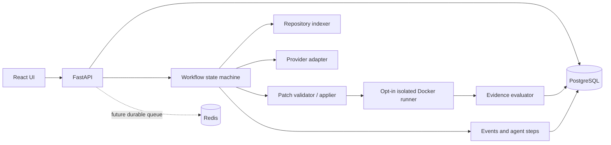

# AegisOS — Portfolio presentation

## One-line pitch
AegisOS is an evidence-first AI engineering workspace that turns repository issues into proposed code changes and refuses to call them fixed without independent evidence.

## Problem and approach
AI-generated patches can be syntactically plausible while being wrong, unsafe, or untested. AegisOS separates model output from deterministic patch validation, isolated execution, test evidence, and final verdict generation. Missing evidence produces `inconclusive`; a reviewer model is advisory only.

## Demo script (5–7 minutes)
1. Start PostgreSQL and Redis with Compose, migrate, and seed the demo account.
2. Sign in and review the dashboard; all counters come from persisted records.
3. Open the seeded Python repository and create an issue with two acceptance criteria.
4. Follow queued → analyzing → planning → generating → testing → evaluating in the task trace.
5. Inspect the generated diff, role steps, test output, and evaluation reasoning. Mock-generated sample patches may be rejected because the hunk does not match source; this is intentional honesty, not a successful fix.
6. Create an experiment. Review measured provider-call latency and sample counts; mock runs are labeled and verdicts remain inconclusive without independent test evidence.
7. Explain the Docker sandbox boundary, default-off policy, and remaining hardening work.

## Architecture diagram

## What to emphasize in an interview
- Treat repository files as untrusted prompt data.
- Keep secrets server-side and avoid logging source content.
- Validate patch paths and hunk context before application.
- Isolate execution with network disabled and resource controls; keep sandbox off when unavailable.
- Distinguish `verified`, `failed`, and `inconclusive` instead of turning every model response into a success.
- Persist workflow events and make cancellation/retries explicit.

## Honest scope statement
This is a portfolio-grade prototype, not a hardened multi-tenant hosted service. The current runner performs Python AST syntax validation, not a universal test runner; it does not install arbitrary project dependencies or prove acceptance criteria. The dispatcher is process-local. Git URL ingestion, durable queue semantics, broader language tooling, token-priced billing, production sandbox isolation, and penetration testing remain future work.
